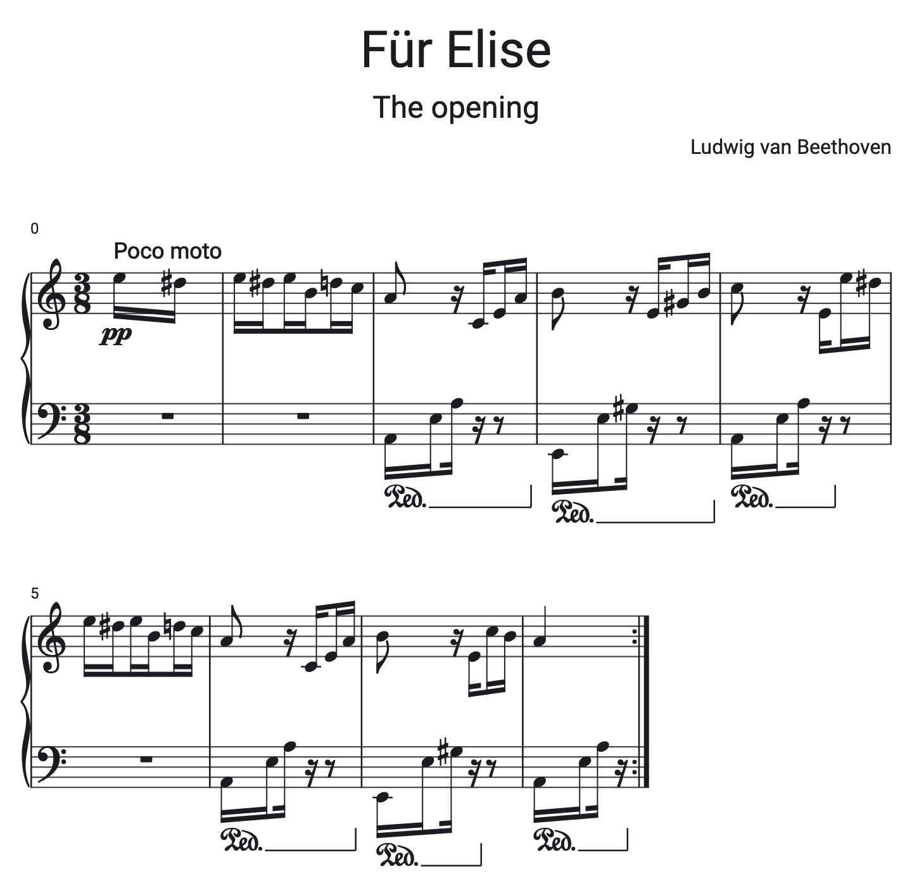
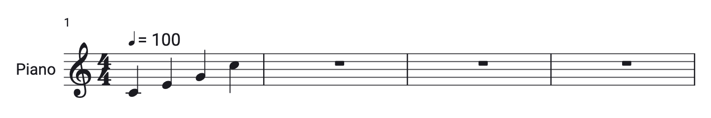

# khuur_sheet_music

Sheet music for Flutter. `SheetView` shows a `Score` as a scrolling sheet. An app edits the score through an `EditSession`, and `ScorePlayer` plays it over MIDI while the sheet follows the sound.

**[Documentation](https://tseku210.github.io/khuur_sheet_music/)** · [Your first sheet](https://tseku210.github.io/khuur_sheet_music/tutorial/first-sheet/) · [How-to guides](https://tseku210.github.io/khuur_sheet_music/guides/show-a-score/) · [Architecture](https://tseku210.github.io/khuur_sheet_music/explanation/architecture/)



## Features

- A sheet that breaks systems at its width, scrolls vertically, and draws with the Bravura music font.
- Edits that undo and redo: notes, chords, rests, tuplets, grace notes, ties, lyrics, slurs, hairpins, pedal lines, clefs, keys, meters, repeats and jumps.
- Entry by tap, with a preview of the note under a held finger.
- Playback through FluidSynth with the SoundFonts that the app supplies, with tempo, loops and reverb. The sheet marks the beat that plays and scrolls to keep it in view.
- MusicXML import and export, MIDI export, and JSON save and load.
- A palette and an engraving style that follow the app's theme, and the sheet's glyphs for the app's own buttons.
- A score model and a layout engine in pure Dart, which a server or a command-line tool can use without Flutter.

## Install

The package is not on pub.dev yet. Depend on the `main` branch of the repository through git. The library depends on its two pure-Dart packages by version, so until they are published, point them at the same repository.

```yaml
dependencies:
  khuur_sheet_music:
    git:
      url: https://github.com/Tseku210/khuur_sheet_music
      ref: main
  material_ui: ^1.11.0

dependency_overrides:
  khuur_score_model:
    git:
      url: https://github.com/Tseku210/khuur_sheet_music
      ref: main
      path: packages/khuur_score_model
  khuur_score_layout:
    git:
      url: https://github.com/Tseku210/khuur_sheet_music
      ref: main
      path: packages/khuur_score_layout
```

The package needs Dart 3.13 and Flutter 3.47.5 or later.

The sheet takes its colours from the `Theme` of [`material_ui`](https://pub.dev/packages/material_ui), the package that replaces `package:flutter/material.dart`. Under a `MaterialApp` of `flutter/material.dart` the sheet finds no theme and draws in the light default colours. To move an app to `material_ui`, follow the migration steps in the README of `material_ui`.

## Quick start

This app writes four notes into a blank score and shows it.

```dart
import 'package:khuur_sheet_music/khuur_sheet_music.dart';
import 'package:material_ui/material_ui.dart';

void main() {
  var session = EditSession.start(
    Score.blank(
      parts: const [
        PartTemplate(
          name: 'Piano',
          instrument: Instrument(key: 'piano', program: 0),
        ),
      ],
      measureCount: 4,
    ),
  );
  for (final name in ['C4', 'E4', 'G4', 'C5']) {
    final edit = EnterNote(
      at: session.cursor,
      tone: Pitch.parse(name),
      value: NoteValue.quarter,
    );
    if (session.run(edit) case Applied(session: final next)) session = next;
  }
  runApp(MaterialApp(home: Scaffold(body: SheetView(score: session.score))));
}
```

The app shows a piano staff with the four notes in the first bar and a rest in each of the other three.



[Your first sheet](https://tseku210.github.io/khuur_sheet_music/tutorial/first-sheet/) goes on from here to entry by tap and playback.

## Platforms

| Platform | Sheet and editing | Playback |
| --- | --- | --- |
| Android | Yes | Yes |
| iOS | Yes | Yes |
| macOS | Yes | No |
| Linux, Windows | Not tested | No |
| Web | No | No |

Playback runs through FluidSynth from [`khuur_synth`](https://github.com/Tseku210/khuur_synth). The library does not compile for the web, because `khuur_synth` uses `dart:ffi`. `khuur_score_model` and `khuur_score_layout` are pure Dart and run anywhere Dart runs. [Platforms and limits](https://tseku210.github.io/khuur_sheet_music/reference/platforms-and-limits/) gives the version floors and what the library does not do.

## Run the example

```bash
cd example
dart run tool/fetch_soundfont.dart
flutter run
```

The first command downloads the example's piano SoundFont, which the repository does not keep. Run it once. The example runs on Android and iOS. It is one page, `example/lib/main.dart`, which shows the tune of `example/lib/demo_score.dart`, enters and selects notes by tap, and plays the score with a tempo slider.

## Work on the package

The repository is a pub workspace of three packages. `packages/khuur_score_model` is the score model, `packages/khuur_score_layout` is the layout engine, and the root package is the Flutter view and the player.


[CONTRIBUTING.md](CONTRIBUTING.md) lists the checks that a change must pass and explains how a pull request lands. The [explanation pages](https://tseku210.github.io/khuur_sheet_music/explanation/architecture/) describe how the model, the layout engine and playback work.

## Licence

The code is under the MIT License. See [LICENSE](LICENSE). The package draws music with Bravura, which it ships under the SIL Open Font License 1.1. See [Fonts and licences](https://tseku210.github.io/khuur_sheet_music/reference/fonts-and-licences/).

## Used by

[Khuur](https://github.com/Tseku210/khuur_app) is the first app that uses the library.
