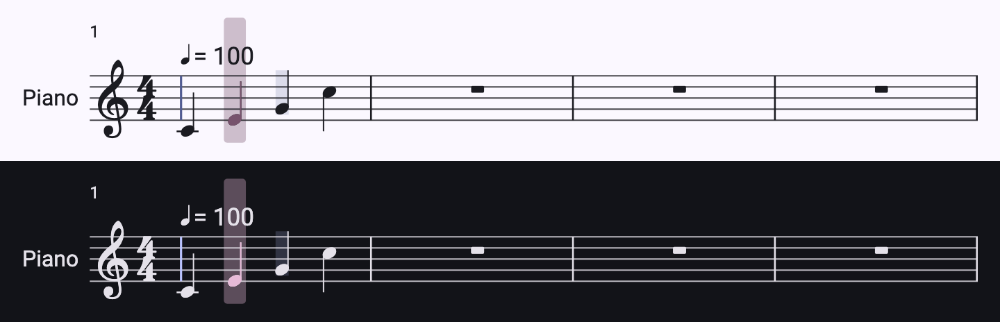

This guide changes the colours, the engraving and the size of a `SheetView`, and the colour of single notes.

Three values of `SheetView` set the look. Each has a default, so you change only what you want.

| Value | What it holds | What a change costs |
| --- | --- | --- |
| `palette` | The colours, and the styles of the selection, the cursor, the playhead and the playing events. | A repaint. Nothing is laid out again. |
| `style` | The music font, text sizes, spacing, line thickness and what is printed. | A new layout of the whole score. |
| `tints` | A colour for one note or one event. | A repaint. |

## Change the colours

When `palette` is null, the view derives one from the ambient `Theme` of `material_ui` with `SheetPalette.of`, so the sheet follows light and dark mode.



To change some colours, call `copyWith` on that palette. It keeps the parts you do not pass.

```dart
SheetView(
  score: score,
  palette: SheetPalette.of(context).copyWith(
    selection: const SheetHighlight(
      fill: Color(0x332962FF),
      border: Color(0xFF2962FF),
      radius: 0.5,
      padding: 0.3,
    ),
    cursor: const SheetLine(color: Color(0xFFD81B60), width: 0.35),
  ),
)
```

The palette has these parts:

| Part | What it colours |
| --- | --- |
| `ink` | Every mark that has no colour of its own. |
| `staffLines` | The staff lines. |
| `outOfRange` | A note that its instrument cannot play. |
| `inks` | One kind of mark, in place of the three parts above. |
| `paper` | The background, on screen and in an exported image. Null draws none. |
| `selection` | The selected notes, lines and ranges, as a `SheetHighlight`. |
| `playback` | The events that play now, rests too, as a `SheetHighlight`. |
| `cursor` | The caret at the edit cursor, as a `SheetLine`. |
| `preview` | The note of `SheetView.preview`. Null draws it in the cursor's colour. |
| `playhead` | A line that moves while the score plays, as a `SheetLine`. |

`copyWith` cannot take a colour away. A null leaves a part as it is, so a palette without its `paper` or its `preview` colour is built with the `SheetPalette` constructor.

### Draw on paper of a fixed colour

The theme's ink is light in dark mode. If you give the sheet a paper of a fixed colour, also give it an ink of a fixed colour, or the notes do not show.

```dart
SheetPalette.of(context).copyWith(
  paper: const Color(0xFFFFF8E1),
  ink: const Color(0xFF2B2118),
  staffLines: const Color(0xFF8A7B6A),
)
```

### Colour one kind of mark

Pass `inks`, a map from `InkRole` to a colour. `InkRole` lists the kinds of mark, such as the stems, the beams, the barlines, the clefs, the lyrics and the dynamics. A kind that is not in the map takes `ink`. The staff lines take `staffLines` and a note out of range takes `outOfRange`, unless the map has a colour for them.

```dart
SheetPalette.of(context).copyWith(
  inks: const {
    InkRole.barline: Color(0xFF9E9E9E),
    InkRole.lyric: Color(0xFF1565C0),
    InkRole.dynamics: Color(0xFFC62828),
  },
)
```

`copyWith(inks:)` replaces the whole map. The palette compares two maps by what they hold, so a map that you build in `build` repaints nothing while its colours stay the same. A new colour for one kind of mark repaints only the systems that show that kind.

### Style the selection and the playing notes

A `SheetHighlight` draws up to three things, and each only when you give it:

- `fill`, a box behind the marked items. The box lies under the notes and the staff lines, so the music stays readable on any fill. Boxes that overlap make one shape.
- `border` and `borderWidth`, a line inside the edge of the box. A width of zero draws no line.
- `ink`, the colour the marked item is drawn in again. For a selected or playing event, the ink reaches the whole chord or rest, with its stem, accidentals and dots. For one selected note of a chord, it reaches the head alone. A selected range gets a box and no ink.

`radius` rounds the corners of the box. `padding` sets how far the box reaches past the notes, and a value under zero makes the box smaller than the notes.

A `SheetLine` has a `color` and a `width`, and a width of zero draws no line. Every length is in staff spaces, so a box and a line grow with the zoom. Do not pass a width or a radius under zero. A debug build refuses it with an assert, and a release build gives it no meaning.

The default `playhead` has a width of zero, so it draws no line. The playhead moves at the pace of the bar's spacing, which does not follow time, and the `playback` box shows the playing events instead. To draw the line anyway, give it a width. This example draws the playing events in green, with no box, and a green playhead.

```dart
SheetPalette.of(context).copyWith(
  playback: const SheetHighlight(ink: Color(0xFF2E7D32)),
  playhead: const SheetLine(color: Color(0xFF2E7D32), width: 0.25),
)
```

Where one note has several colours, the selection's ink covers a tint, and the playback ink covers both.

## Change the engraving

`EngravingStyle` holds everything that changes the layout. Every part has a default, so `EngravingStyle(staffGap: 6)` changes one part. To change a style you already have, call `copyWith`.

```dart
SheetView(
  score: score,
  style: const EngravingStyle(
    justify: false,
    barNumbers: false,
    staffGap: 6,
    text: {TextRole.lyric: TextSpec(size: 2.4, italic: true)},
  ),
)
```

The style has these parts:

| Part | What it sets |
| --- | --- |
| `text` | A `TextSpec` for a `TextRole`, with a size in staff spaces, `italic`, `bold` and a font `family`. A role that is not in the map keeps its default. |
| `spacing` | A `SpacingPolicy`, with the space after a quarter note, the ratio between a note and one twice as long, the least gap between glyphs, the padding at the start of a bar and the width of a run of empty bars. |
| `staffGap`, `lyricGap`, `systemGap` | The clear space between staves, above a row of lyrics and between systems, in staff spaces. |
| `graceScale` | The size of grace notes against other notes. |
| `barNumbers`, `courtesySignatures`, `meterEverySystem`, `multiMeasureRests` | What is printed. |
| `justify`, `justifyLastSystemFrom` | Whether systems stretch to the full width, and how full the last system must be before it stretches. |
| `quarterTones`, `stringNumbers`, `chordSymbols` | Which glyphs and spellings these marks use. |
| `font` | The music font, with the thickness of every line. |

With `justify: false` every system keeps its natural width, so a bar added at the end never moves the bars before it. An editor turns justification off for that reason.

The view compares styles by value, so a style that you build in `build` lays nothing out again while its values stay the same.

### Change the thickness of the lines

The stems, the beams, the barlines, the staff lines and the other lines take their thickness from the font's `EngravingDefaults`, in staff spaces. To change them, give the style a copy of the font with other defaults.

```dart
const font = SmuflFont.bravura;

SheetView(
  score: score,
  style: EngravingStyle(
    font: font.copyWith(
      defaults: font.defaults.copyWith(
        stemThickness: 0.16,
        staffLineThickness: 0.1,
      ),
    ),
  ),
)
```

A thickness of zero draws no line. An assert refuses a default under zero or one that is not a finite number. The engine draws nothing with `arrowShaftThickness`, `bracketThickness`, `dashedBarlineDashLength`, `dashedBarlineGapLength`, `hBarThickness` and `subBracketThickness`, so a change to one of those changes nothing.

### Use another SMuFL font

The package bundles Bravura. To draw with another SMuFL font, declare the font in your app's `pubspec.yaml`, add the font's metadata file to your assets, and parse it with `SmuflFont.fromMetadata`.

```dart
final metadata =
    jsonDecode(await rootBundle.loadString('assets/fonts/metadata.json'))
        as Map<String, Object?>;
final font = SmuflFont.fromMetadata(family: 'MyMusicFont', metadata: metadata);
```

`family` is the name that your `pubspec.yaml` gives the font. The font must have every glyph the engine draws. `fromMetadata` throws one `FormatException` that names every problem it finds, such as a glyph with no box or an engraving default that the metadata lacks. Parse the metadata once and keep the font. A font parsed again is not equal to the first, so a style that holds it lays the whole score out again.

## Change the size

- `staffSpace` is the number of logical pixels per staff space at zoom 1. The default is 8.
- `SheetController.zoom` multiplies `staffSpace`. A new zoom breaks the lines again.
- `padding` is the room around the sheet, which scrolls with it.

```dart
SheetView(
  score: score,
  staffSpace: 10,
  padding: const EdgeInsets.symmetric(horizontal: 24, vertical: 16),
)
```

## Colour single notes

Pass `tints`, a map from an `ElementRef` to a colour, for marks such as practice feedback, a colour per voice or a colour per pitch. A tint on an `EventRef` colours the whole chord or rest. A tint on a `NoteRef` colours that head alone.

```dart
SheetView(
  score: score,
  tints: {for (final event in wrong) event: const Color(0xFFC62828)},
)
```

The view repaints its tints when you pass a map that is another object.

## Related pages

- [Draw the sheet's glyphs in your own widgets](/khuur_sheet_music/guides/glyphs-in-your-widgets/)
- [Play a score](/khuur_sheet_music/guides/play-a-score/)
- [Export an image](/khuur_sheet_music/guides/export-an-image/)
- [How the layout engine works](/khuur_sheet_music/explanation/layout-engine/)
- [Fonts and licences](/khuur_sheet_music/reference/fonts-and-licences/)
